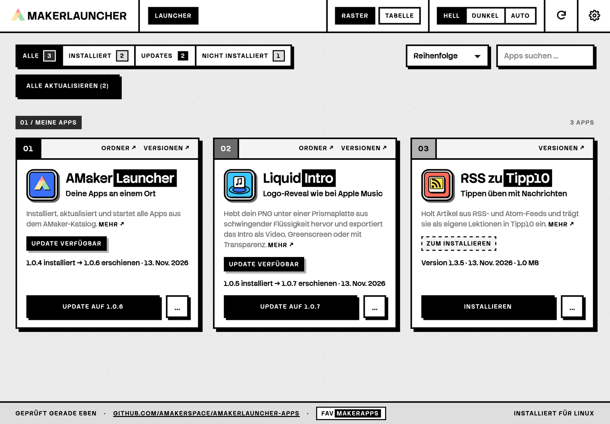
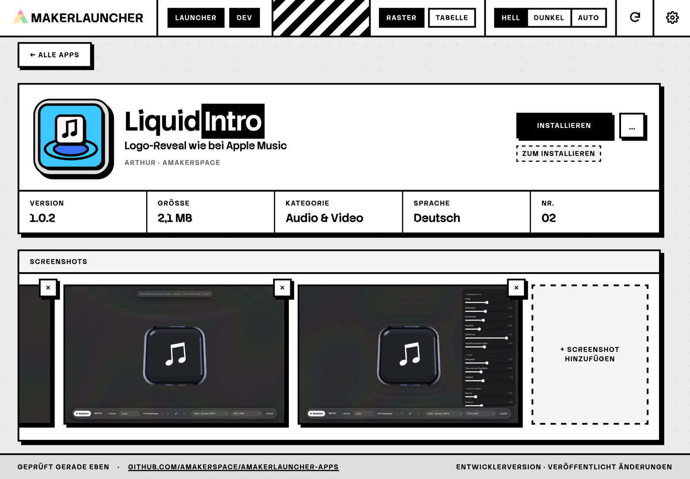
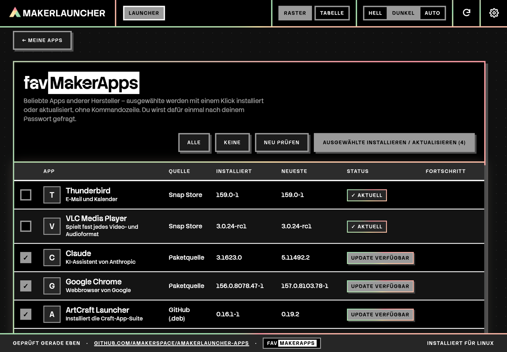

<p align="center">
  
</p>

<h1 align="center">AMakerLauncher</h1>

<p align="center">
  <b>Deine Apps an einem Ort – installieren, aktualisieren, starten.</b><br>
  Ein kleiner Launcher für Ubuntu im Neo-Brutalismus-Stil, mit eigenem App-Katalog und favMakerApps.
</p>

<p align="center">
  <a href="#installation"><b>Installation</b></a> ·
  <a href="#apps-im-katalog">Apps</a> ·
  <a href="#favmakerapps">favMakerApps</a> ·
  <a href="#so-funktioniert-es">So funktioniert es</a> ·
  <a href="#deinstallieren">Deinstallieren</a>
</p>

<p align="center">
  
</p>

## Installation

Ein Befehl im Terminal genügt (Ubuntu 22.04 oder neuer, Debian 12 oder neuer):

```bash
curl -fsSL https://raw.githubusercontent.com/AMakerSpace/AMakerLauncher/main/install.sh | bash
```

Das Skript

1. installiert fehlende Systempakete (`python3-gi`, `gir1.2-webkit2-4.1`) – nur dann fragt es nach deinem Passwort,
2. holt die neueste Version aus dem Katalog und prüft ihre **SHA-256-Prüfsumme**,
3. installiert den Launcher für deinen Benutzer nach `~/.local/share/amakerlauncher` – mit Eintrag im App-Menü und der Schrift *Stack Sans Notch*.

Danach findest du **AMakerLauncher** im App-Menü. Ab da aktualisiert sich der Launcher selbst.

> Lieber erst lesen, dann ausführen? Gute Idee:
> ```bash
> curl -fsSL https://raw.githubusercontent.com/AMakerSpace/AMakerLauncher/main/install.sh -o install.sh
> less install.sh
> bash install.sh
> ```

## Was der Launcher kann

| | |
|---|---|
| **Installieren mit einem Klick** | Lädt die App, prüft die Prüfsumme, legt den Menüeintrag an und bringt mitgelieferte Schriften mit. |
| **Immer aktuell** | Prüft regelmäßig auf Updates, meldet sie per Benachrichtigung und aktualisiert alles mit „Alle aktualisieren“. |
| **Detailseiten wie im App Store** | Screenshots, Beschreibung, Funktionen, „Neu in dieser Version“, Infos und Versionsverlauf. |
| **Raster & Tabelle** | Filter (Alle, Installiert, Updates, Nicht installiert), Sortierung und Suche. |
| **Hell, Dunkel, Auto** | Im Dunkelmodus leuchten die Ränder im Verlauf der Logofarben. Die App-Icons wechseln mit dem Systemmodus zwischen weißer und schwarzer Kachel. |
| **favMakerApps** | Beliebte Apps anderer Hersteller ohne Kommandozeile installieren und aktualisieren. |

<p align="center">
  
</p>

## Apps im Katalog

| | App | Worum es geht |
|---|---|---|
|  | **AMakerLauncher** | Dieser Launcher – er aktualisiert sich selbst. |
|  | **LiquidIntroMaker** | Logo-Reveal wie bei Apple Music: Dein PNG taucht unter einer Prismaplatte aus schwingender Flüssigkeit auf. Echte Wellensimulation, physikalisch berechnete Farbsäume, Export als MP4, Greenscreen oder ProRes mit Transparenz. |
|  | **RSSMaker** | RSS-Reader: alle Feeds in einer Liste, Ungelesenes markiert, Artikel merken und im Volltext lesen – und jeden Artikel mit einem Klick als Tipp10-Lektion zum Tippen-Üben. |

Neue Apps und Versionen erscheinen automatisch im Launcher.

## favMakerApps

Unten im Launcher führt **favMakerApps** zu einer Liste beliebter Apps anderer Hersteller. Abwählen, was du nicht willst – der Rest wird mit **einer** Passwortabfrage installiert oder aktualisiert, ganz ohne Terminal:

Thunderbird · VLC Media Player · Claude · Google Chrome · ArtCraft Launcher · Visual Studio Code · Obsidian · Discord · Raspberry Pi Imager

Jede App kommt über ihren offiziellen Weg: den **Snap Store**, die **Paketquelle des Herstellers** (Claude, Chrome, VS Code – wird bei Bedarf eingerichtet, der Claude-Schlüssel wird gegen seinen veröffentlichten Fingerabdruck geprüft) oder das **.deb aus den GitHub-Releases** (ArtCraft Launcher). Die neuesten Versionen fragt der Launcher direkt bei der Quelle ab.

<p align="center">
  
</p>

## So funktioniert es

```
github.com/AMakerSpace/amakerlauncher-apps
├── catalog.json          ← Liste aller Apps mit Version, Download, Prüfsumme, Texten
├── icons/                ← App-Icons
├── screenshots/          ← Screenshots für die Detailseiten
└── Releases              ← jede App-Version als .tar.gz (z. B. liquid-intro-v1.0.7)
```

Der Launcher liest nur den Katalog und lädt Releases – kein eigener Server, keine Anmeldung, kostenlos über GitHub.
Installiert wird nach `~/.local/share/amakerlauncher/apps/<app>`, Menüeinträge landen in `~/.local/share/applications`.

### Für Entwickler: die Dev-Version

Neben dem normalen Launcher gibt es **AMakerLauncher Dev** (Icon mit `</>`). Er beobachtet die Quellordner der Apps: Sobald eine App bearbeitet wird, zeigt er die geänderten Dateien und veröffentlicht nach kurzer Wartezeit automatisch eine neue Version – Release, Icon, Screenshots und Katalog. Versionsnummern zählt er selbst hoch.

Jede App beschreibt sich mit einer `app.json`:

```json
{
  "id": "liquid-intro",
  "name": "LiquidIntroMaker",
  "version": "1.0.7",
  "subtitle": "Logo-Reveal wie bei Apple Music",
  "description": "Kurzbeschreibung für die Karte",
  "long_description": "Ausführlicher Text für die Detailseite",
  "features": ["…"],
  "screenshots": ["screenshots/1-reveal.png"],
  "icon": "icon/liquid-intro-256.png",
  "exec": "liquid-intro.py",
  "desktop_id": "de.arthur.LiquidIntro",
  "categories": "AudioVideo;Video;",
  "fonts": ["fonts/StackSansNotch-VariableFont_wght.ttf"],
  "requires": [{"cmd": "ffmpeg", "apt": "ffmpeg"}]
}
```

## Updates

Der Launcher sucht stündlich nach Updates (einstellbar unter ⚙) und aktualisiert auch sich selbst. Das Installationsskript kann jederzeit erneut ausgeführt werden – es installiert dann einfach die neueste Version.

## Deinstallieren

```bash
curl -fsSL https://raw.githubusercontent.com/AMakerSpace/AMakerLauncher/main/uninstall.sh | bash
```

Deine über den Launcher installierten Apps bleiben dabei erhalten. Alles entfernen, inklusive dieser Apps:

```bash
curl -fsSL https://raw.githubusercontent.com/AMakerSpace/AMakerLauncher/main/uninstall.sh | bash -s -- --alles
```

## Voraussetzungen

- Ubuntu 22.04+ oder Debian 12+ (64 Bit)
- `python3`, `python3-gi`, `gir1.2-webkit2-4.1` – installiert das Skript bei Bedarf
- Für favMakerApps: `snapd` und `pkexec` (bei Ubuntu vorinstalliert)

## Schrift

Die Oberfläche nutzt **Stack Sans Notch** von [The Stack Sans Project Authors](https://github.com/DylanYoungKoto/Stack-Sans), lizenziert unter der SIL Open Font License 1.1 (liegt dem Launcher als `fonts/OFL.txt` bei).

---

<p align="center"><sub>Gemacht von Arthur · AMakerSpace</sub></p>
